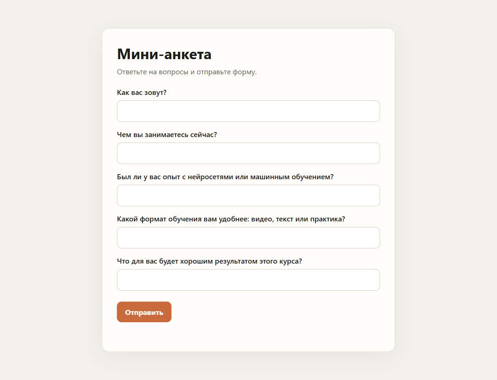
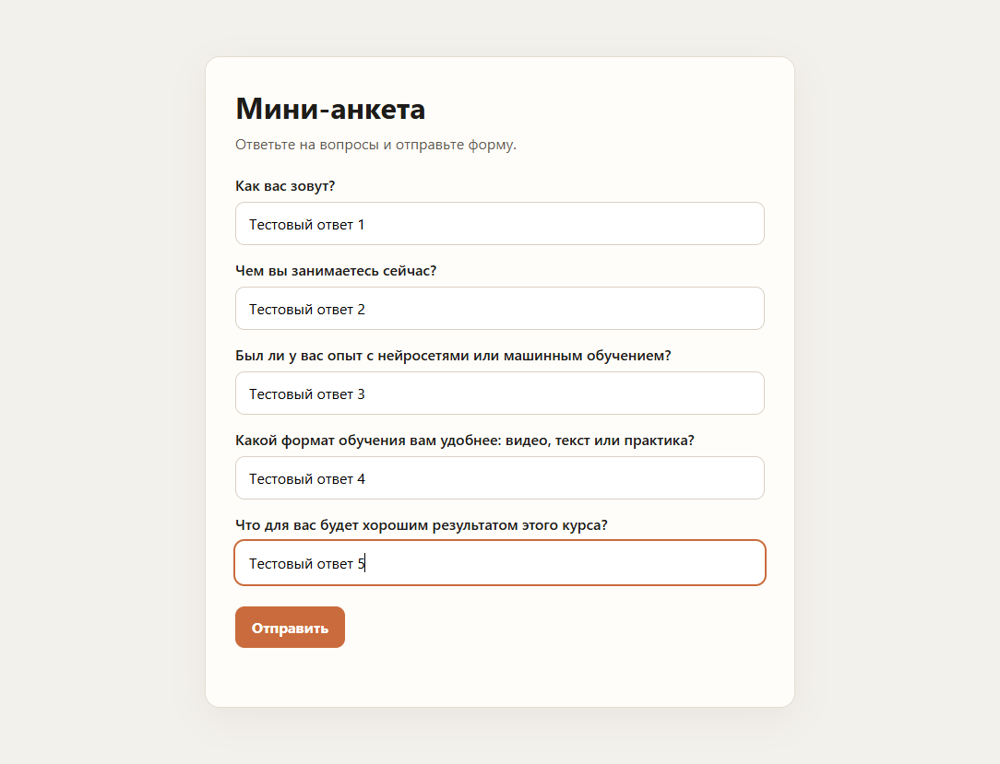
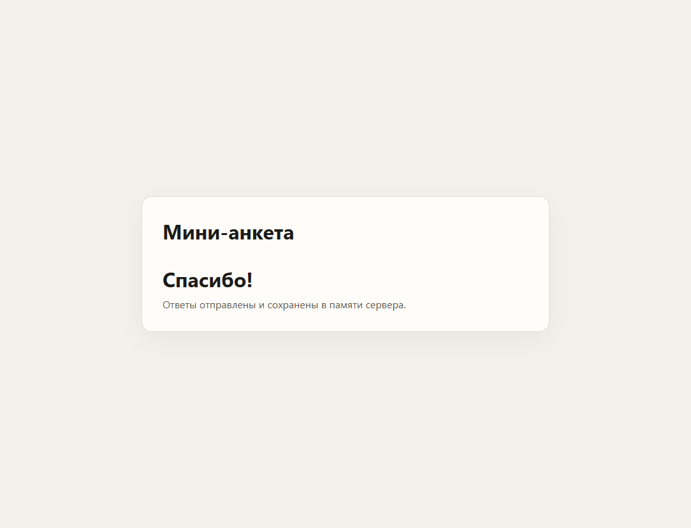

# Отчёт: мини-анкета

Стенд собран в Cursor агентом. Ниже не итоговое «что получилось», а ход сессии: промпты целиком, где инструмент остановился или мог увести не туда, и чем это кончилось.

## Выбранный AI-setup

- IDE: Cursor, режим агента. Агент сам создаёт файлы и запускает команды, а не только подсказывает код в чате.
- Модель: Grok 4.7.
- Плагины под задачу не ставились. В этой сессии у агента не было браузера: открыть страницу и кликнуть форму из IDE было нельзя.
- Git: локальный репозиторий в папке задания. Имя и почта в git уже были настроены, конфиг агент не менял. Удалённого remote в этой сессии нет.
- Стек стенда: Python 3.13, FastAPI 0.136.1, Uvicorn 0.46.0, страница на HTML, CSS и JS без сборки. Страницу отдаёт тот же процесс, что и API, поэтому отдельный frontend-сервер и CORS не нужны.

Запуск описан в `README.md`. Проверка в этой сессии: сервер на `http://127.0.0.1:8000`, сценарий «вопросы → форма → отправка → Спасибо!» пройден.

## Рассмотренные альтернативы

Инструмент уже был открыт: Cursor. Другие варианты для такой домашки:

- Чат в браузере (ChatGPT, Claude, веб-версия Grok). Код пришлось бы переносить в файлы самому и самому запускать сервер. Для задания «максимально делегируй и смотри» это слабее: не видно, запускает ли модель то, что написала.
- VS Code и GitHub Copilot. Удобно дописывать функции в уже существующем проекте. Слабее, когда папка пустая и нужно дойти до запущенного приложения.
- Другая модель в том же Cursor (Claude, GPT). Не переключался. Смысл менять модель появился бы, если бы агент зациклился на одной ошибке. Здесь смена не понадобилась.

Стек:

- Node.js и React или Vue. Больше файлов, npm и шаг сборки. Для пяти вопросов это лишнее.
- Go. Для курса по нейросетям менее привычен, чем Python, а выигрыша у этого стенда нет.
- Два процесса, API и статика порознь. Появился бы CORS, и первая же проверка из браузера легко упала бы на заголовках.

Остался Python и одна команда `uvicorn`: агент и пишет код, и может сразу его запустить.

## Ход работы

### Промпт 1

```
я прохожу обучение по нейросетям. Мне нужно сделать домашнее задание, нужна твоя помощь. текст задания сейчас прюшлю. Обязательно разворачиваем гит
```

Текста задания в сообщении не было. Агент посмотрел папку: файлов нет. `git status` вернул `fatal: not a git repository`. В PowerShell это рисуется как ошибка `NativeCommandError`, хотя git просто сообщает, что репозитория ещё нет. Следующая команда — `git init` — прошла, репозиторий пустой.

Агент не стал выдумывать приложение и остановился, пока нет задания. Для отчёта это удачная остановка. Для скорости — лишний круг: после первого сообщения кода ещё не существовало.

### Промпт 2

```
## Что нужно сделать

Соберите с помощью выбранного AI-инструментария (IDE + ассистент/агент) минимальное full-stack приложение «Мини-анкета». Приложение — тестовый стенд, а не результат: оно нужно, чтобы прогнать инструмент на реальной задаче и понять, где он помогает, а где мешает. Максимально делегируйте работу инструменту и наблюдайте за ним; если текущий не устраивает — по ходу дела попробуйте другой.

Требования
Backend, два эндпоинта:
GET /questions — список из 3–5 жёстко заданных вопросов;
POST /answers — приём ответов и хранение в памяти (slice/array/map).
Frontend: загружает вопросы, отображает форму, отправляет ответы, показывает «Спасибо!».
Стек на выбор: backend — Python, Node.js/TS, Go; frontend — HTML+JS, React, Vue.
Приложение запускается локально.
Шаги
Зафиксируйте стартовый setup — IDE, ассистент/агент, модель, плагины.
Сгенерируйте структуру проекта через ассистента, а не руками.
Сгенерируйте backend и frontend, доводя код до рабочего состояния в диалоге с инструментом.
Запустите приложение и проверьте сценарий целиком: вопросы загружаются, ответы отправляются.
Фиксируйте по ходу промпты, неудачные попытки и смены инструмента — это материал для REPORT.md."
Формат сдачи
Ссылка на git-репозиторий с приложением-полигоном и короткой инструкцией по запуску.
REPORT.md в корне репозитория (или в корне папки с заданием).
Скриншоты работы приложения.
REPORT.md — главный артефакт этого ДЗ. Именно его в первую очередь читает и оценивает проверяющий: код, приложение и конфиги нужны как подтверждение того, что описанное в отчёте действительно было сделано.

Требования к отчёту — единые для всех ДЗ курса:

Формат — Markdown.
Имя файла — REPORT.md, в корне репозитория (или в корне папки с заданием).
Содержание — история работы, а не сводка результата. Из отчёта должно быть видно, как вы шли к результату:
все использованные промпты — полным текстом, а не пересказом;
неудачные попытки — что не получилось, что модель поняла не так, где пришлось переформулировать задачу, сменить подход или инструмент;
как вы это чинили и к чему в итоге пришли;
выводы: что сработало, а что нет.
Отчёт без промптов и без разбора неудачных попыток считается неполным.

Дополнительно в этом ДЗ отчёт должен содержать:

Выбранный AI-setup — какой набор инструментов вы использовали (IDE/редактор, ассистент/агент, модель, плагины) и как он настроен.
Рассмотренные альтернативы — какие ещё варианты вы взвешивали и почему выбрали именно этот; чем он оказался предпочтительнее.
Впечатления и мысли — как инструмент показал себя на задаче: что понравилось, что ускоряло работу, а что мешало или разочаровало.
Возникшие проблемы — с какими трудностями, ошибками и ограничениями инструмента вы столкнулись и как их обходили.
Вывод — подтверждаете ли вы свой выбор или решили его пересмотреть (и в пользу чего)."

Критерии оценки:
Работа считается выполненной, если:

Приложение-полигон собрано и запускается — реализован требуемый функционал (GET /questions, POST /answers, фронтенд). Работоспособность важна как свидетельство того, что инструмент действительно был обкатан на реальной задаче.
Приложен REPORT.md со всеми пятью блоками: выбранный AI-setup, рассмотренные альтернативы, впечатления, возникшие проблемы, вывод.
Выбор инструментария отрефлексирован осмысленно — в отчёте видно не формальное «всё понравилось», а конкретные наблюдения о сильных и слабых сторонах инструмента на этой задаче.
Сделан вывод — студент явно подтверждает свой выбор или обосновывает решение его пересмотреть.
Ключевой артефакт оценки — REPORT.md. Работа без отчёта, без полных промптов или без разбора неудачных попыток возвращается на доработку, даже если код рабочий. Оценивается осмысленность работы с инструментом, а не сложность или «красота» самого приложения.
```

Переформулировать промпт не пришлось: во втором сообщении были и эндпоинты, и состав отчёта. Агент разложил проект сам: `backend/main.py`, `frontend/`, `requirements.txt`, `README.md`, `.gitignore`.

### Правка до первого запуска

В первой записи модели ответа стояло `value: str = Field(min_length=1)`. Строка из одних пробелов такую проверку проходит, а после `strip()` в память попал бы пустой ответ. До старта сервера агент заменил это на `field_validator`: пробелы обрезаются, пустое значение отвергается. Это не падение в рантайме, а правка, которую инструмент внёс сам, перечитав только что написанный код. Снаружи диалога я эту дырку не указывал.

### Проверка API

Сервер поднялся командой `uvicorn backend.main:app --host 127.0.0.1 --port 8000`. Зависимости из `requirements.txt` встали с первой попытки, версии FastAPI и Uvicorn агент указал сам, без предварительного просмотра PyPI.

Дальше агент дернул API из Python:

- `GET /questions` — 200, пять вопросов.
- `GET /` — HTML страницы.
- `POST /answers` дважды — `id` равен 1, затем 2. Список в памяти растёт.
- пустой список ответов — 422.
- `question_id` 99 — 400.
- значение из пробелов — 422.

На этом шаге консоль PowerShell показала русский текст как `��� ��� �����?`. Это кодировка консоли, не ответ сервера. Если верить только логу, следующий шаг был бы «починить UTF-8 в FastAPI». Чинка была бы ложной: браузер ниже рисует те же строки нормально.

### Скриншоты

Встроенного браузера в сессии не было, поэтому сценарий кликов агент закрыл обходным путём: поставил Selenium в уже созданное `.venv` и открыл системный Chrome. Selenium в `requirements.txt` не входит, скрипт съёмки в репозиторий не клался. Это проверка, не часть приложения.

Форма после загрузки `GET /questions`:



Те же поля, заполненные перед отправкой:



После `POST /answers` форма скрывается, на странице «Спасибо!»:



Смены инструмента не было. Обходной путь понадобился только для картинок.

## Впечатления и мысли

Ускоряло то, что агент не останавливается на куске кода. За один проход после второго промпта появились файлы, виртуальное окружение, запущенный сервер и проверка обоих эндпоинтов. Папку и git он посмотрел до того, как что-то писать, и не начал приложение, пока задания не было.

Мешало другое.

Лог в PowerShell легко принять за поломку. `git status` до `git init` выглядит как авария. Кириллица в том же терминале выглядит как битая кодировка приложения. Инструмент сам не перепутал одно с другим, но читать его промежуточный вывод глазами неприятно: полезный сигнал и шум оформлены одинаково.

Проверка интерфейса из коробки не замкнулась. Агент умеет запустить uvicorn и дернуть HTTP, но кнопки «Отправить» в этой сессии нажать было нечем, пока он не поставил отдельный Selenium. Для домашки, где как раз нужно «прогнать сценарий целиком», это заметная дыра. Код при этом был рабочий, дыра была в оснастке агента, не в анкете.

Отчёт тоже написал агент, тем же промптом, которым собиралось приложение. Наблюдения выше привязаны к конкретным командам этой сессии, а не к общей оценке «инструмент понравился». Личный тон проверяющий здесь не получит: формулировки собраны моделью по своим же действиям. Это ограничение такого способа делать домашку, и его лучше не маскировать.

## Возникшие проблемы

1. Репозитория не было. `git status` завершился `fatal: not a git repository`, PowerShell показал это как исключение. Обход: `git init` в папке задания.
2. Консоль не UTF-8. Русский JSON в логе нечитаем. Обход: не менять код приложения, сверить текст по скриншоту страницы.
3. Нет браузера у агента. Обход: Chrome и Selenium, три файла в `screenshots/`.
4. Ответы живут в списке процесса. После остановки uvicorn они пропадают. Так и задумано в задании, это записано в `README.md`, чтобы не искать «базу».
5. Ссылки на удалённый репозиторий агент не создал. Локальный git есть, URL для сдачи нужно завести отдельно, если площадка его требует.

## Вывод

Выбор подтверждаю: Cursor в режиме агента на Grok 4.7 для этого стенда подходит. Пустая папка дошла до запускаемых `GET /questions` и `POST /answers` и до страницы с «Спасибо!» без смены инструмента и без ручной перекладки файлов.

Пересматривать IDE я бы не стал. Пересмотреть оснастку имело бы смысл на следующей задаче, если основной сценарий — клики в браузере: здесь этого канала не было, и проверку UI пришлось выносить в Selenium. Модель менять тоже нет причины, пока агент не начинает крутить одну и ту же ошибку. На этой домашке такого не случилось.

Стек оставляю тем же. Python и один процесс оказались удобнее React, Vue и отдельного frontend-сервера: меньше шагов до локального запуска и не всплыл CORS.
